# v3 「코디세이로 오라」 바다판 컷 리스트 (한 컷 = 한 사람 대사)

만드는 순서: 캐릭터 디자인 시트(gpt-image-2) → 씬 키프레임(gpt-image-2) → 컷별 veo 클립 → 편집.
COPA 영상 API가 이미지 입력을 받지 않아(테스트로 확인) 시트에서 본 생김새를 글로 옮겨 매 컷 프롬프트에 똑같이 넣는다.
말하는 사람이 섞이지 않도록 **한 컷에 한 사람만 말한다.** 대사가 여럿이어도 같은 사람의 대사만 한 컷에 둔다.

## 캐릭터

| 인물 | 디자인 시트 | 고정 묘사(프롬프트에 그대로) |
|---|---|---|
| 사부 | 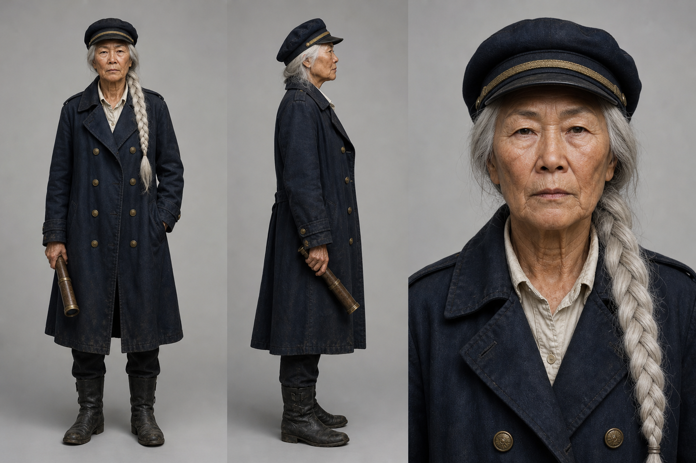 | a fictional Korean woman in her 60s, a sea captain, very long silver-white hair in one thick braid hanging over her left shoulder, deeply wrinkled tanned stern face, dark navy captain's cap with a thin gold band, long weathered dark navy double-breasted coat with brass buttons over an off-white collared shirt, black boots, a brass spyglass in her hand |
| 소라 |  | a fictional Korean woman in her 20s, round thin gold wire-frame glasses, black hair with wispy bangs in a low ponytail tied with a bright yellow scrunchie, cream knit cardigan over a white t-shirt, light blue jeans, white sneakers, hugging a stack of paperback books |
| 도현 | 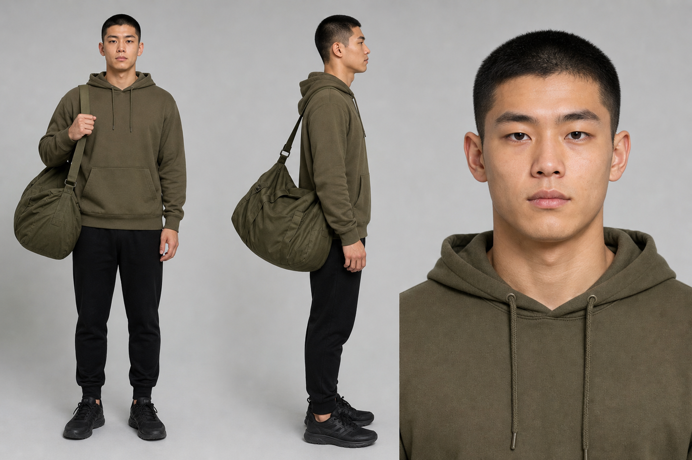 | a fictional Korean man in his 20s, very short black buzz-cut hair, plain olive-khaki hoodie, black jogger pants, black sneakers, a big olive duffel bag on his right shoulder, civilian clothes, no uniform, no camouflage |
| 민석 | 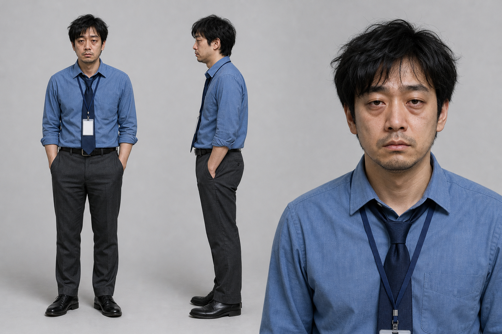 | a fictional Korean man in his 30s, messy black hair, heavy eye bags, light stubble, cobalt-blue dress shirt with rolled-up sleeves, loose navy tie, white ID badge on a navy lanyard, charcoal slacks |

## 컷 리스트

| 컷 | 씬 | 길이 | 말하는 사람 | 대사 | 화면 | 슈퍼 |
|---|---|---|---|---|---|---|
| C01 | S01 파도의 신호 | 4초 | 사부 | 파도가… 말했다. | Slow push-in from a wide aerial view of the ship crashing through waves to a medium shot of 사부 at the bow facing the camera, coat and braid whipping in the wind. |  |
| C02 | S02 국문과 | 4초 | 사부 | 깨어나라, 그대여. 코디세이로 오라.<br>동작: 0-1s she extends the brass spyglass and points it dramatically down toward the camera | Low-angle medium shot of 사부 leaning over the ship's rail. |  |
| C03 | S02 국문과 | 4초 | 소라 | …저 국문과인데요?<br>동작: 0-1s she blinks twice and points at herself with one finger | High-angle medium close-up of 소라 standing alone on the pier, looking up. Nobody else is visible. |  |
| C04 | S02 국문과 | 4초 | 사부 | 나는 항해학과였다.<br>동작: 0-1.5s she stays silent and slowly raises ONE eyebrow very high, an exaggerated, clearly visible comedic eyebrow raise, the rest of her face perfectly still | Tight close-up of 사부's face at the rail, filling the frame. |  |
| C05 | S03 빈 문틀 | 4초 | 소라 | 어? 문이… 없네요?<br>동작: 0-1.5s she walks through the empty wooden door frame, then stops and looks back at the frame, surprised | Medium shot of 소라 alone. |  |
| C06 | S03 빈 문틀 | 4초 | 사부 | 문턱도 없다. | Medium shot of 사부 alone at the top of the gangway, arms crossed. | 전공·경력 무관 |
| C07 | S04 빈 지갑 | 4초 | 사부 | 그대 안의 코드가… 깨어났다.<br>동작: 0-1s she slowly extends the brass spyglass toward the camera with a grand gesture | Medium shot of 사부 on the deck rail. |  |
| C08 | S04 빈 지갑 | 4초 | 도현 | 충성! / …근데 통장이 비었습니다!<br>동작: 0-1s he snaps a crisp military salute / 1.5-3.5s he pulls out a brown leather wallet and opens it wide toward the camera, showing it is completely empty | Medium shot of 도현 alone on the pier, framed from the knees up so his hands are clearly visible. |  |
| C09 | S04 빈 지갑 | 4초 | 사부 | 그건 바다가 채운다.<br>동작: 0-1s she stays silent, then gives one slow, flat nod | Close-up of 사부 at the rail. |  |
| C10 | S05 장학금 | 4초 | 도현 | …진짜 채워지는데요?<br>동작: 0-1s a wave crashes against the pier and a burst of glittering golden spray pours straight into his open wallet, clearly visible | Medium shot of 도현 alone at the edge of the pier, holding out his open wallet. |  |
| C11 | S05 장학금 | 4초 | 사부 | 장학금이다. | Medium close-up of 사부 on the deck, golden spray glittering in the air behind her. | 장학금 |
| C12 | S06 23층 | 4초 | 사부 | 지친 자여… 코디세이로 오라.<br>동작: 0-1s she taps the end of the brass spyglass twice on the outside of the window glass, tap tap, clearly visible and audible | Shot from inside the dark office looking at the big window. Outside the window, 사부 stands at the rail of the floating ship, right against the glass, completely outside the building. Nobody else is in the office except an empty desk in the foreground. |  |
| C13 | S06 23층 | 4초 | 민석 | …저 내일 출근인데요.<br>동작: 0-1s he is hunched over his keyboard, then turns only his head toward the window, slowly, with an exhausted face | Medium shot of 민석 alone at his desk. |  |
| C14 | S06 23층 | 4초 | 사부 | 괜찮다… 24시간 개방이다.<br>동작: 0-1s she gives a small reassuring nod and opens her free hand, palm up | Medium close-up of 사부 at the rail of the floating ship outside the office window, seen through the glass. |  |
| C15 | S07 동료와 함께 | 4초 | 민석 | 혼자서는… 어려워요.<br>동작: 0-1s he lets out a small tired sigh and looks down at the sea | Close-up of 민석 alone, leaning on the ship's rail, shoulders slumped. |  |
| C16 | S07 동료와 함께 | 6초 | 사부 | 혼자 하지 않는다. / 주변 동료들과 함께한다.<br>동작: 0-1s she turns and sweeps her open hand toward the groups of people studying together behind her | Medium shot of 사부 standing at the rail; behind her on the deck, small groups of young people study together around laptops, clearly visible. | 동료학습 |
| C17 | S08 동료 | 4초 | 도현 | 충성! 기수가 어떻게 되십니까!<br>동작: 0-1s the young man snaps a crisp salute toward the office worker | Medium two-shot of 도현 and 민석 facing each other on deck. |  |
| C18 | S08 동료 | 6초 | 사부 | 기수 없다. 모두가 함께 동료다. / 나도 배우는 중이다. | Medium shot of 사부 alone at the ship's wheel, calm. |  |
| C19 | S09 엔드카드 | 6초 | 사부 | 코디세이로 와라!<br>동작: 2-3s the old captain alone turns her head back over her shoulder toward the camera with a solemn, intense look | IMPORTANT: the camera is behind them and we see their backs. Wide shot from behind of exactly four people standing side by side in a row at the bow, facing the sunrise, no one else: from left to right, 사부, 소라, 도현 and 민석. Nobody wears a black jacket. 0-2s: silence, only waves. | 엔드카드 |

총 19컷, 생성 길이 합계 82초. 편집에서 컷마다 대사 앞뒤만 남겨 57~60초로 줄인다.

## 씬 키프레임

### S01 파도의 신호
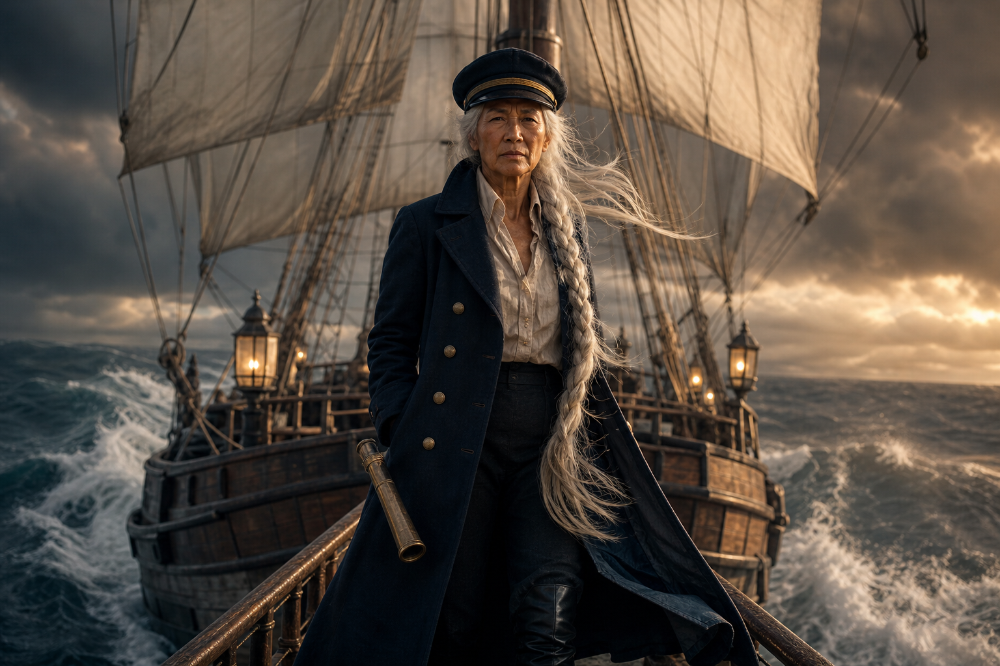

### S02 국문과
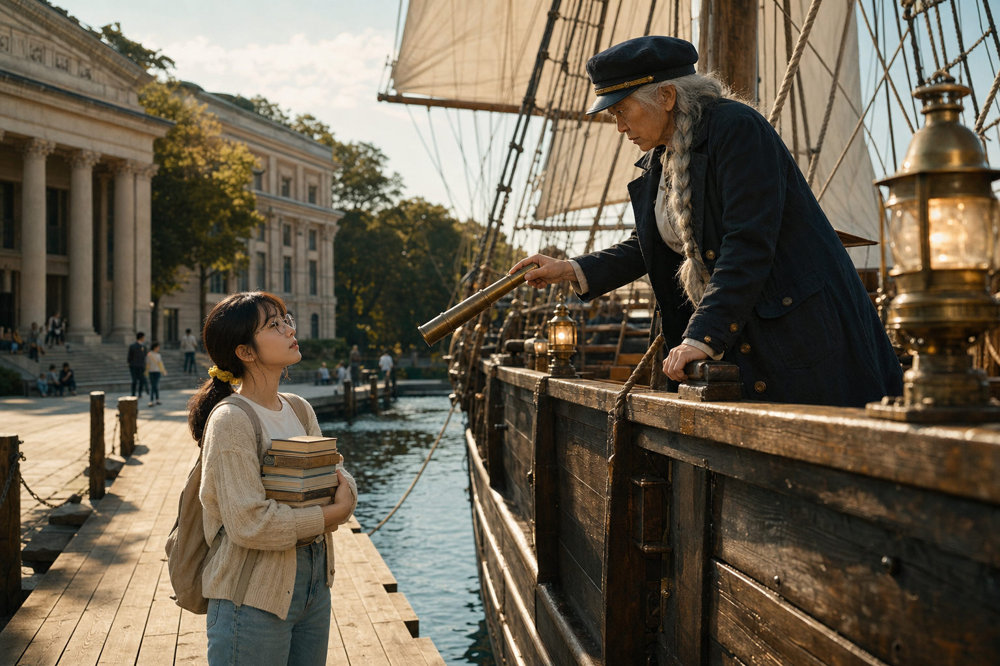

### S03 빈 문틀
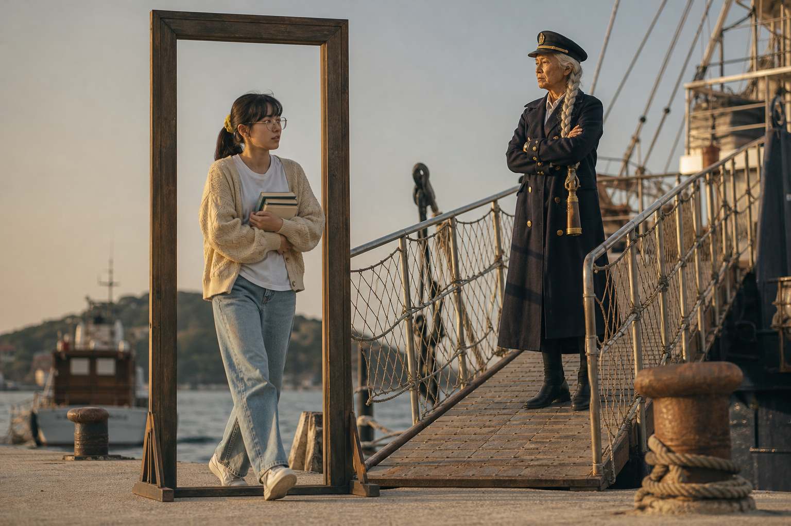

### S04 빈 지갑
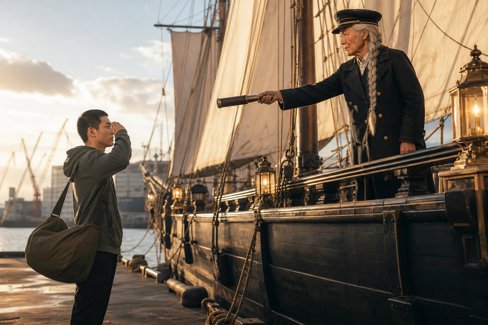

### S05 장학금
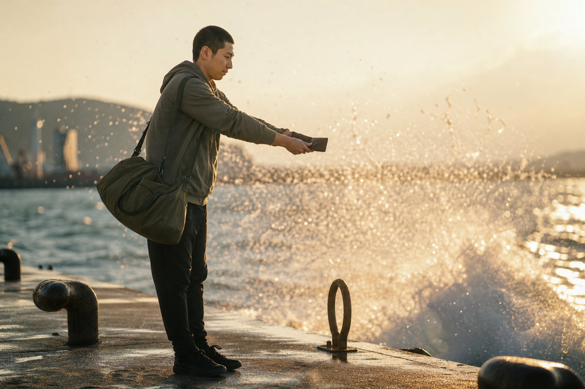

### S06 23층
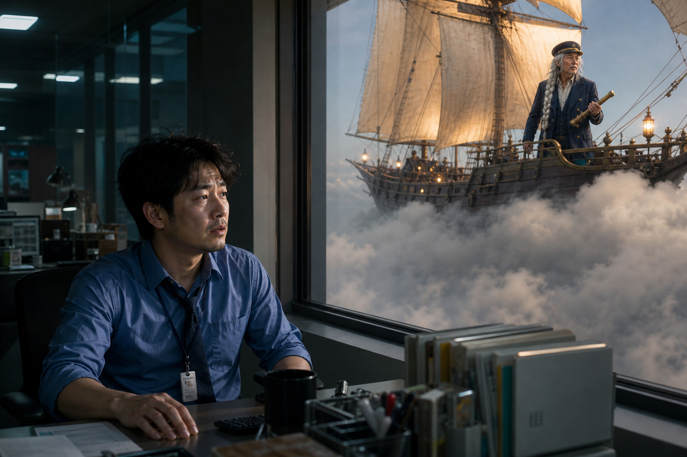

### S07 동료와 함께
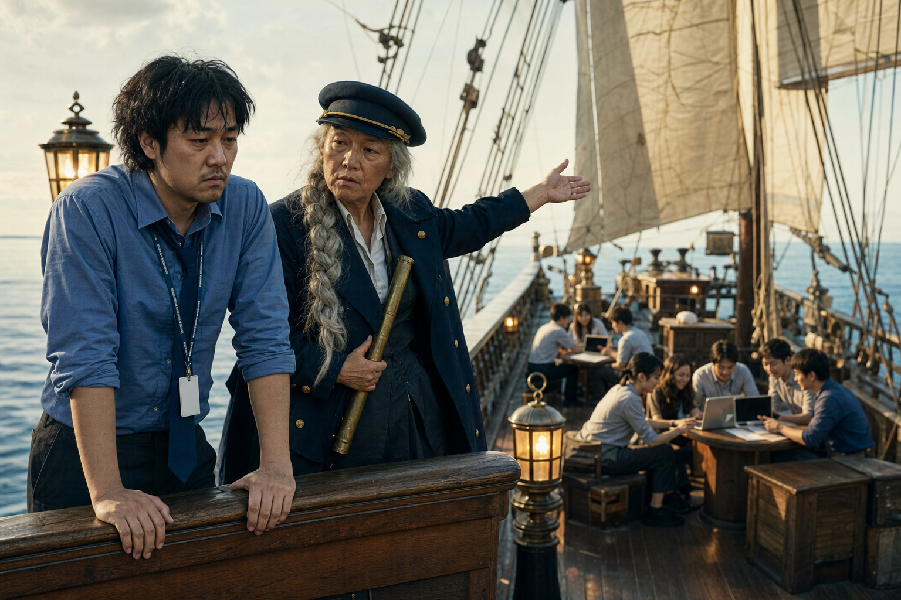

### S08 동료
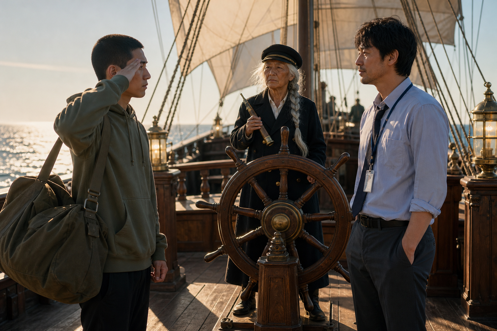

### S09 엔드카드
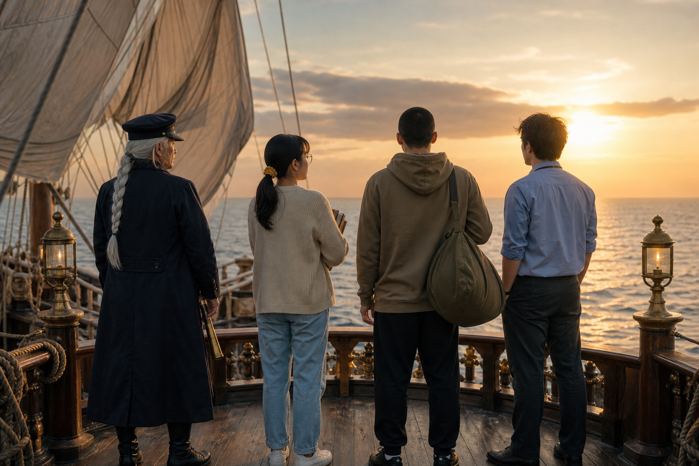

## 프롬프트 예시 (C02)

```
Setting: at a sunny wooden pier in front of a riverside university library, with the ship (an old three-masted wooden sailing ship with huge cream-white sails and warm brass lanterns, no flags, no writing on the hull) docked alongside the pier. Low-angle medium shot of the old captain (a fictional Korean woman in her 60s, a sea captain, very long silver-white hair in one thick braid hanging over her left shoulder, deeply wrinkled tanned stern face, dark navy captain's cap with a thin gold band, long weathered dark navy double-breasted coat with brass buttons over an off-white collared shirt, black boots, a brass spyglass in her hand) leaning over the ship's rail. VISUAL ACTION, clearly visible and large in frame, not skipped: From 0s to 1s, she extends the brass spyglass and points it dramatically down toward the camera. DIALOGUE AND LIP-SYNC: only the old captain speaks in this clip, in a low, calm, slightly husky elderly woman's voice. While speaking, the speaker's face and mouth are clearly visible to the camera and the lips move in exact sync with every Korean syllable. From 0.5s to 3.5s, the speaker says in a grand, slow voice, exactly once and word for word, in Korean: "깨어나라, 그대여. 코디세이로 오라." Outside these times the speaker's mouth stays closed. Everyone else in the frame stays completely silent with mouth closed and never speaks. Only one voice is heard in the whole clip, no other speech, no extra words. The last line ends at least 0.5 seconds before the clip ends. AUDIO: clean, clear, close-miked dialogue at a natural speaking pace, quiet natural ambience under it, no background music, no narration, no laughter, no singing. Cinematic live-action Korean TV commercial, 35mm anamorphic lens, shallow depth of field, golden-hour natural light, deadpan comedic tone with a perfectly serious epic sea-voyage film look, natural skin texture, 16:9, no outer space, no stars in the daytime sky, no swords, no weapons, no on-screen text, no subtitles, no captions, no logos, no watermark. All dialogue is spoken in Korean only, never in any other language.
```

전체 프롬프트는 `build/v3c/cNN.prompt.txt`. 재생성은 `.venv/bin/python scripts/cuts.py v3`.
