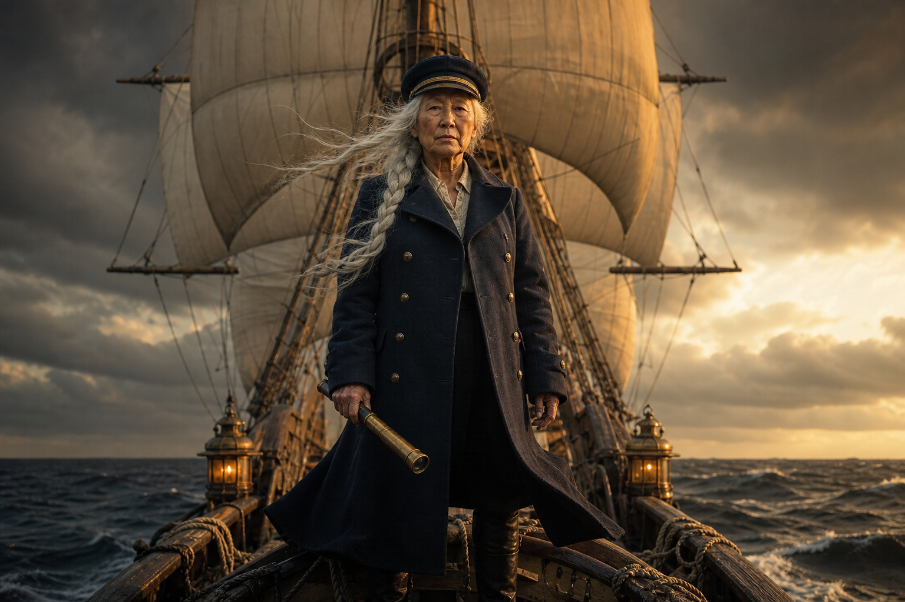
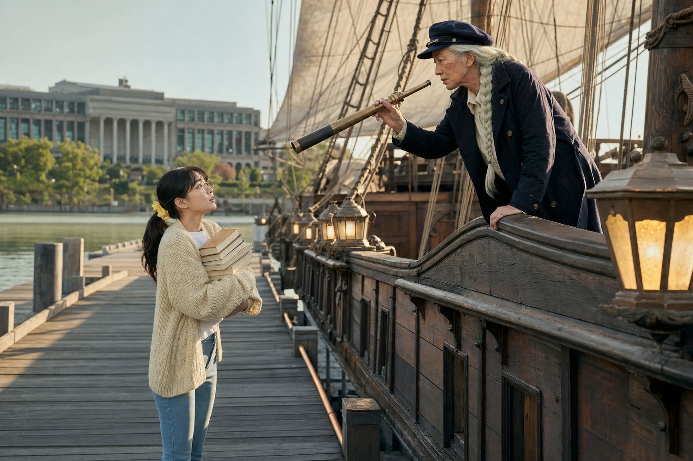
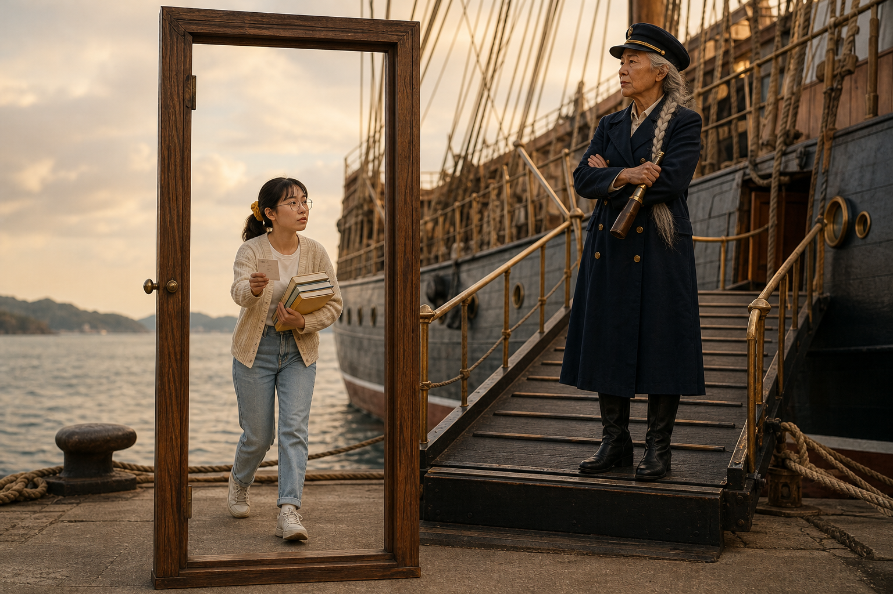
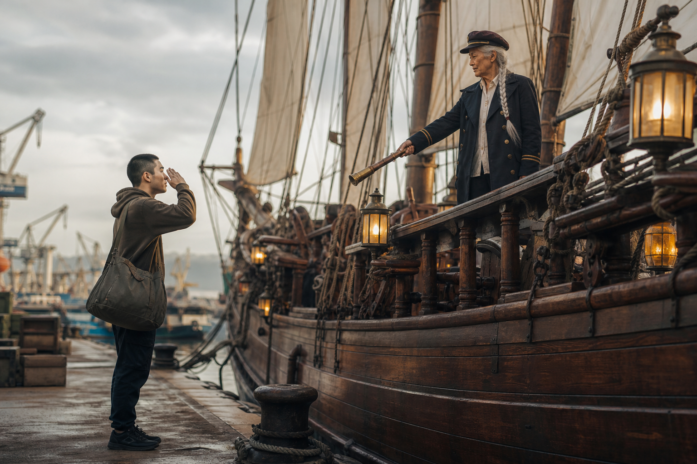
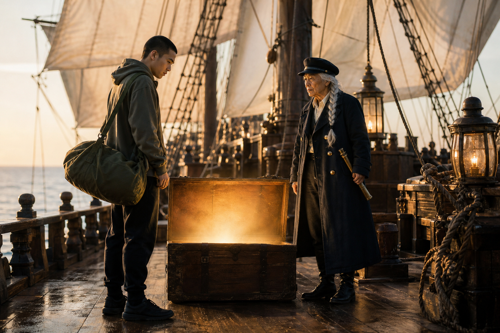
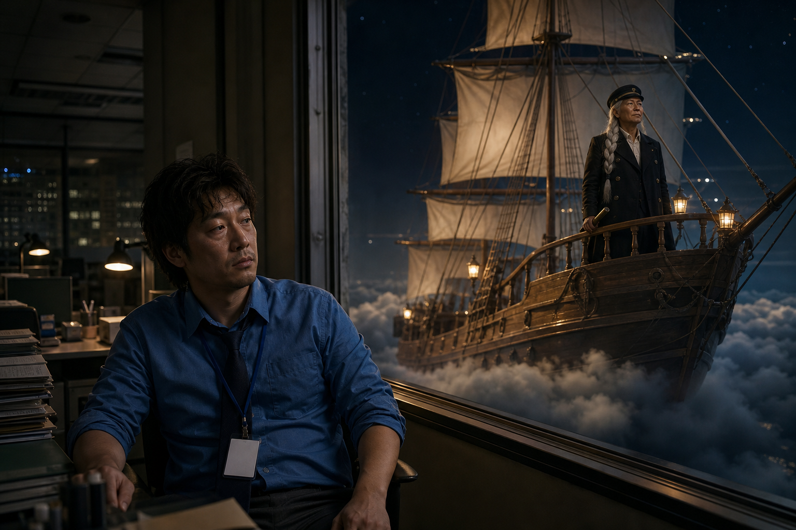
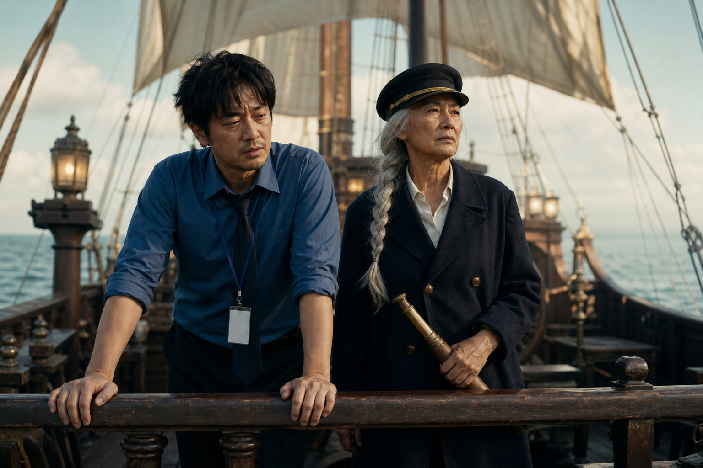
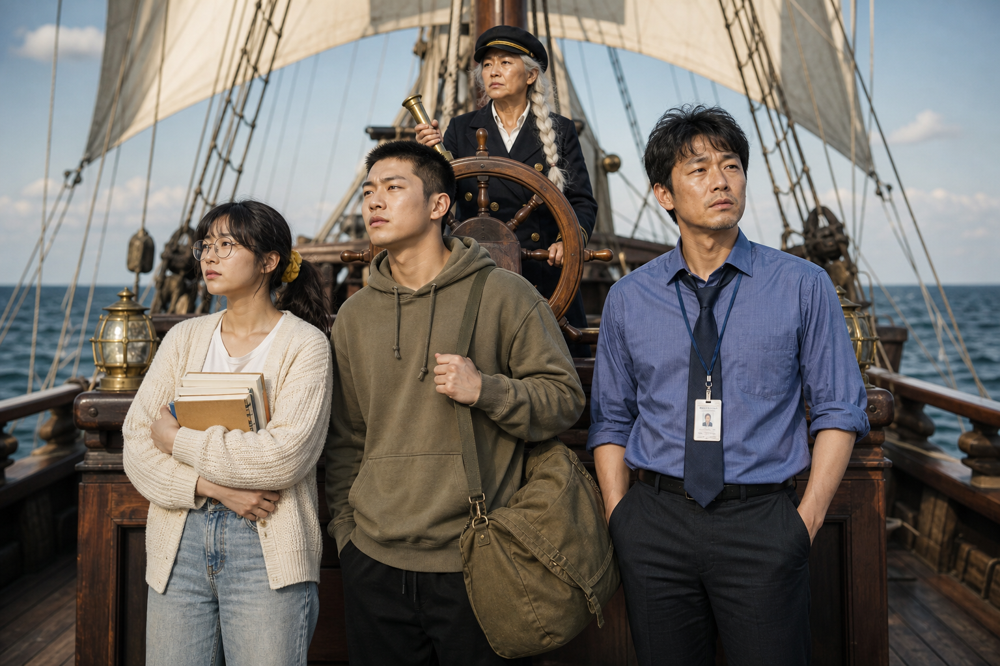
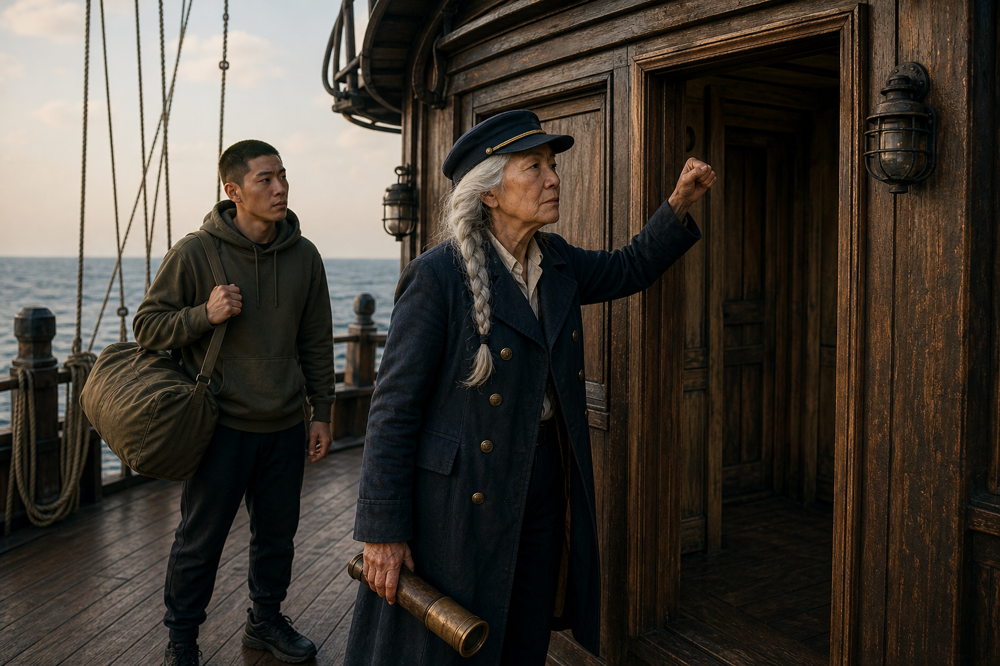
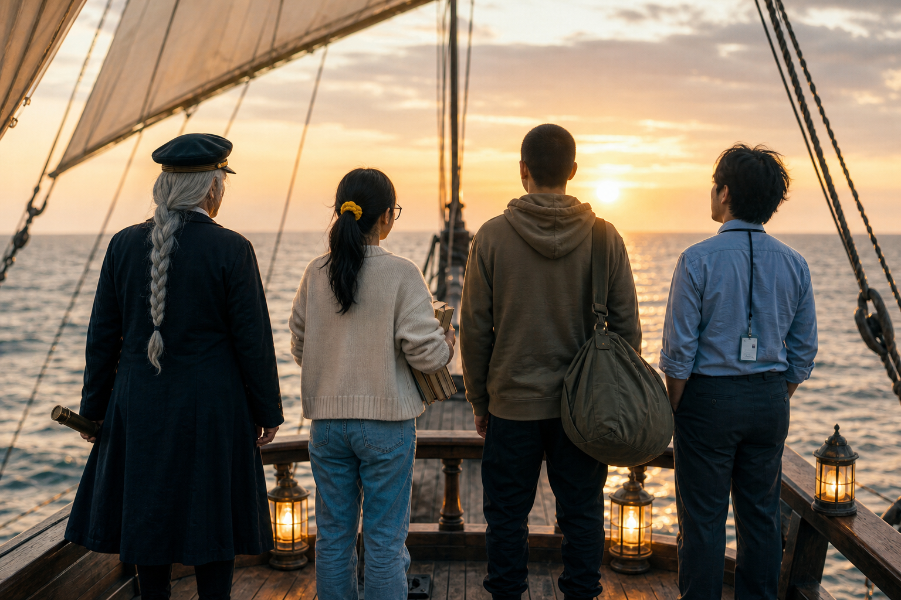

# v4 「코디세이호, 승선하라」 컷 리스트 (한 컷 = 한 사람 대사)

만드는 순서: 캐릭터 디자인 시트(gpt-image-2) → 씬 키프레임(gpt-image-2) → 컷별 veo 클립 → 편집.
COPA 영상 API가 이미지 입력을 받지 않아(테스트로 확인) 시트에서 본 생김새를 글로 옮겨 매 컷 프롬프트에 똑같이 넣는다.
말하는 사람이 섞이지 않도록 **한 컷에 한 사람만 말한다.** 대사가 여럿이어도 같은 사람의 대사만 한 컷에 둔다.

## 캐릭터

| 인물 | 디자인 시트 | 고정 묘사(프롬프트에 그대로) |
|---|---|---|
| 선장 |  | a fictional Korean woman in her 60s, a sea captain, very long silver-white hair in one thick braid hanging over her left shoulder, deeply wrinkled tanned stern face, dark navy captain's cap with a thin gold band, long weathered dark navy double-breasted coat with brass buttons over an off-white collared shirt, black boots, a brass spyglass in her hand |
| 소라 |  | a fictional Korean woman in her 20s, round thin gold wire-frame glasses, black hair with wispy bangs in a low ponytail tied with a bright yellow scrunchie, cream knit cardigan over a white t-shirt, light blue jeans, white sneakers, hugging a stack of paperback books |
| 도현 |  | a fictional Korean man in his 20s, very short black buzz-cut hair, plain olive-khaki hoodie, black jogger pants, black sneakers, a big olive duffel bag on his right shoulder, civilian clothes, no uniform, no camouflage |
| 민석 |  | a fictional Korean man in his 30s, messy black hair, heavy eye bags, light stubble, cobalt-blue dress shirt with rolled-up sleeves, loose navy tie, white ID badge on a navy lanyard, charcoal slacks |

## 컷 리스트

| 컷 | 씬 | 길이 | 말하는 사람 | 대사 | 화면 | 슈퍼 |
|---|---|---|---|---|---|---|
| C01 | S01 출항 신호 | 6초 | 선장 | 바람이… 바뀌었다. / 모집 기간이다. | Slow push-in from a wide aerial view of the ship to a medium shot of 선장 at the bow facing the camera, coat and braid whipping in the wind. |  |
| C02 | S02 국문과 | 4초 | 선장 | 그대. 승선하라. | Low-angle medium shot of 선장 leaning over the ship's rail, dramatically pointing the brass spyglass down toward the camera. |  |
| C03 | S02 국문과 | 4초 | 소라 | 저요? …저 국문과인데요. | High-angle medium close-up of 소라 standing on the pier, looking up, blinking, pointing at herself. |  |
| C04 | S02 국문과 | 4초 | 선장 | 그래서? | Close-up of 선장 at the rail. 0-2s: silence, only seagulls; she slowly raises one eyebrow and nothing else. |  |
| C05 | S03 빈 문틀 | 4초 | 소라 | …어? 표 검사 안 해요? | Medium shot: 소라 walks through the empty door frame holding out a blank paper ticket, then stops and looks around, confused. |  |
| C06 | S03 빈 문틀 | 4초 | 선장 | 원래 없었다, 문턱. | Medium shot of 선장 at the top of the gangway, arms crossed. | 전공·경력 무관 |
| C07 | S04 빈 지갑 | 4초 | 선장 | 그대 안에서… 코드가 깨어났다. | Medium shot of 선장 on the deck rail, extending the brass spyglass toward the camera with a grand gesture. |  |
| C08 | S04 빈 지갑 | 4초 | 도현 | 충성! / …근데 저 돈이 없습니다! | Medium shot of 도현 on the pier: he snaps a crisp salute, then turns his empty wallet upside down and a small puff of dust falls out. |  |
| C09 | S04 빈 지갑 | 4초 | 선장 | 알고 있다. 그래서 준다. | Close-up of 선장. 0-1s: silence; then she nods once, flatly. |  |
| C10 | S05 장학금 | 4초 | 도현 | …뭘요? | Medium shot of 도현 on deck staring at the glowing open chest, puzzled. |  |
| C11 | S05 장학금 | 4초 | 선장 | 장학금. | Medium close-up of 선장 beside the glowing chest, golden light on her face. | 장학금 |
| C12 | S06 23층 | 4초 | 선장 | 지친 자여… 코디세이로 오라. | Shot from inside the office toward the window: outside, 선장 stands at the floating ship's rail and taps on the glass with her spyglass. |  |
| C13 | S06 23층 | 4초 | 민석 | …여기 23층인데요. | Medium shot of 민석 at his desk, slowly turning only his head toward the window, exhausted. |  |
| C14 | S07 혼자 | 4초 | 민석 | 저 혼자 하면… 맨날 포기해요. | Close-up of 민석 leaning on the rail, looking down at the sea. |  |
| C15 | S07 혼자 | 4초 | 선장 | 그래서 혼자 안 시킨다. | Medium close-up of 선장 standing next to him, looking at the horizon. | 동료학습 |
| C16 | S08 동료 | 4초 | 도현 | 충성! 동기입니까! | Medium shot: 도현 salutes 민석 and 소라 eagerly. |  |
| C17 | S08 동료 | 6초 | 선장 | 동료다. / 이 배에선 서로가 선장이고 선생이다. | Medium shot of 선장 at the ship's wheel, calm. |  |
| C18 | S08 동료 | 4초 | 소라 | 같이 갑시다! | Wide shot of 소라, 도현 and 민석 side by side; 소라 raises her fist, the two men grin and nod. |  |
| C19 | S09 노크 | 4초 | 도현 | …문 없는데요. | Medium shot: 선장 in the foreground raises her fist to knock on the empty air inside the door frame and freezes; 도현 stands behind her. |  |
| C20 | S09 노크 | 4초 | 선장 | 알고 있다. | Close-up of 선장, fist still raised; she clears her throat awkwardly. |  |
| C21 | S10 엔드카드 | 6초 | 선장 | 코디세이로 와라! | Wide shot from behind of exactly four people at the bow facing the sunrise: 선장, 소라, 도현 and 민석. 0-2s: silence, only waves. Then the captain alone turns her head back over her shoulder toward the camera. | 엔드카드 |

총 21컷, 생성 길이 합계 90초. 편집에서 컷마다 대사 앞뒤만 남겨 57~60초로 줄인다.

## 씬 키프레임

### S01 출항 신호


### S02 국문과


### S03 빈 문틀


### S04 빈 지갑


### S05 장학금


### S06 23층


### S07 혼자


### S08 동료


### S09 노크


### S10 엔드카드


## 프롬프트 예시 (C02)

```
Setting: at a sunny wooden pier in front of a riverside university library, with the ship (an old three-masted wooden sailing ship with huge cream-white sails and warm brass lanterns, no flags, no writing on the hull) docked alongside the pier. Low-angle medium shot of the captain (a fictional Korean woman in her 60s, a sea captain, very long silver-white hair in one thick braid hanging over her left shoulder, deeply wrinkled tanned stern face, dark navy captain's cap with a thin gold band, long weathered dark navy double-breasted coat with brass buttons over an off-white collared shirt, black boots, a brass spyglass in her hand) leaning over the ship's rail, dramatically pointing the brass spyglass down toward the camera. DIALOGUE AND LIP-SYNC: only the captain speaks in this clip, in a low, calm, slightly husky elderly woman's voice. While speaking, the speaker's face and mouth are clearly visible to the camera and the lips move in exact sync with every Korean syllable. From 0s to 3s, the speaker says in a grand, slow voice, exactly once and word for word, in Korean: "그대. 승선하라." Outside these times the speaker's mouth stays closed. Everyone else in the frame stays completely silent with mouth closed and never speaks. Only one voice is heard in the whole clip, no other speech, no extra words. The last line ends at least 0.5 seconds before the clip ends. AUDIO: clean, clear, close-miked dialogue at a natural speaking pace, quiet natural ambience under it, no background music, no narration, no laughter, no singing. Cinematic live-action Korean TV commercial, 35mm anamorphic lens, shallow depth of field, golden-hour natural light, deadpan comedic tone with a perfectly serious epic sea-adventure look, natural skin texture, 16:9, no outer space, no swords, no weapons, no on-screen text, no subtitles, no captions, no logos, no watermark. All dialogue is spoken in Korean only, never in any other language.
```

전체 프롬프트는 `build/v4c/cNN.prompt.txt`. 재생성은 `.venv/bin/python scripts/cuts.py v4`.
